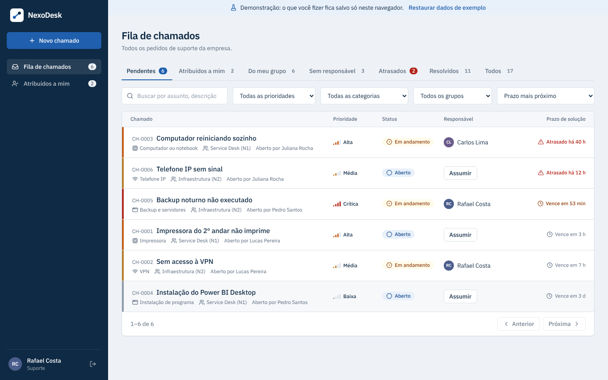
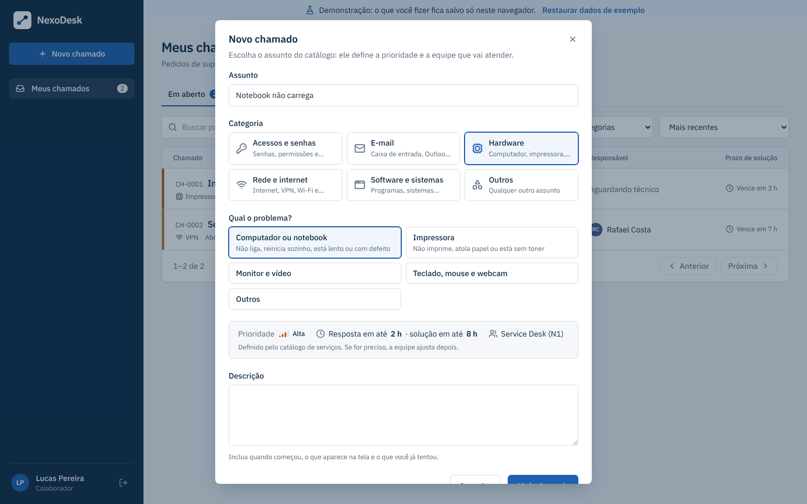
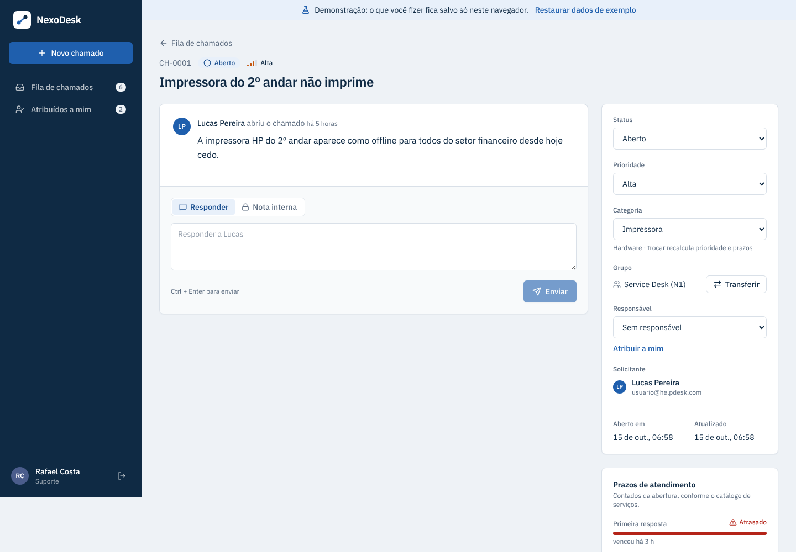
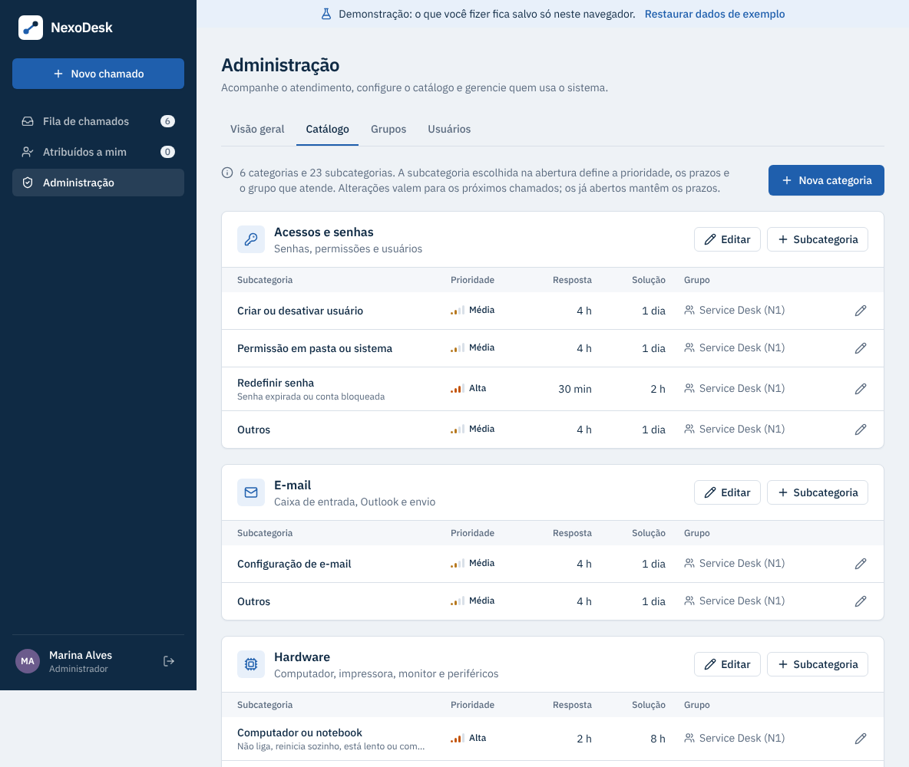
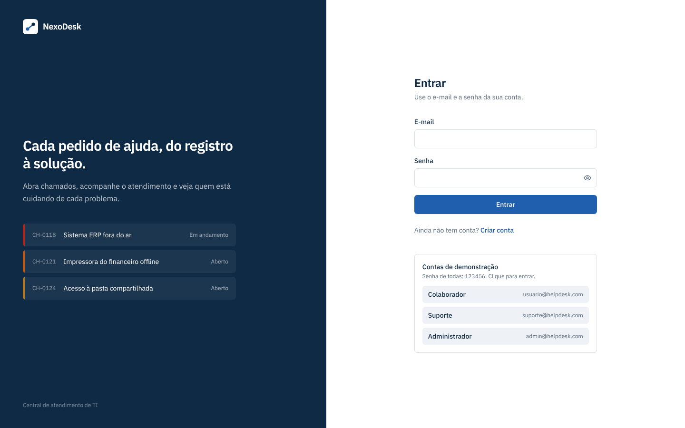
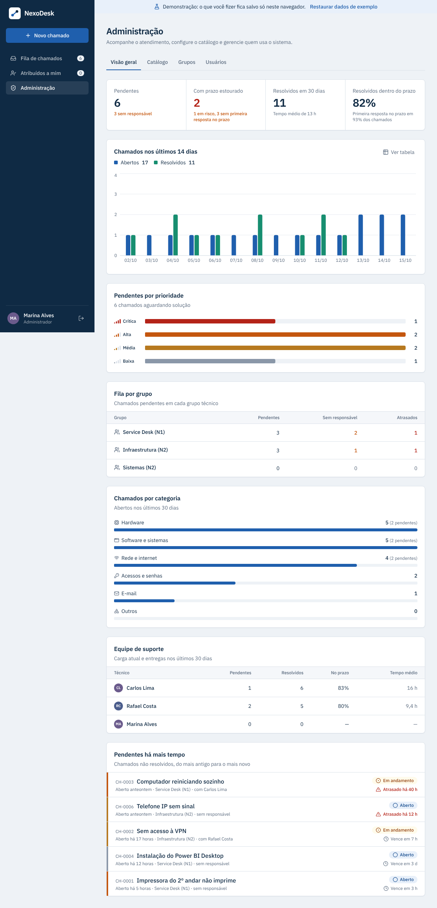

# NexoDesk: Helpdesk System

Central de atendimento de TI full-stack, no modelo de ferramentas como o GLPI: o colaborador abre o chamado pelo catálogo de serviços, a subcategoria define a prioridade, os prazos e o grupo que atende (N1, N2…), a equipe assume, conversa, transfere e resolve, e o administrador acompanha tudo por indicadores.

Nasceu da minha rotina como Analista de Suporte N1: a ideia é reproduzir o ciclo de vida real de um chamado, da abertura à resolução, com o fluxo de trabalho de ferramentas corporativas de service desk.

[](https://github.com/JolivanAbreu/Helpdesk-System/actions/workflows/ci.yml)


**[Abrir a demonstração](https://nexodesk.vercel.app)**: as contas de acesso aparecem na tela de login.



## ✨ Funcionalidades

**Catálogo de serviços e grupos técnicos**
- Categorias e subcategorias (ex.: *Software › Sistema fora do ar*). Cada subcategoria define **prioridade**, **prazo de resposta**, **prazo de solução** e o **grupo** que recebe o chamado
- O solicitante não escolhe urgência: escolhe o assunto, e vê na hora a prioridade, os prazos e quem vai atender
- Grupos técnicos (Service Desk N1, Infraestrutura N2, Sistemas N2), e um técnico pode estar em vários
- **Transferência** para outro grupo e/ou técnico com **motivo obrigatório**, registrado no histórico: é assim que o N1 escala para o N2
- O admin edita o catálogo e os grupos pela própria interface

**Prazos de atendimento (SLA)**
- Os prazos são **gravados no chamado na abertura**: editar o catálogo depois não muda o histórico de SLA
- A fila mostra quanto falta ou há quanto tempo o prazo venceu, e começa pelos mais atrasados
- Aba "Atrasados", barras de prazo consumido no chamado e indicadores de cumprimento no painel do admin
- A primeira mensagem da equipe registra a resposta; reclassificar a subcategoria ou mudar a prioridade recalcula os prazos

**Fila de atendimento**
- Prioridade (crítica, alta, média, baixa) com faixa colorida em cada chamado para triagem rápida
- Responsável por chamado: assumir pela lista, atribuir a outro técnico ou devolver para a fila
- Abas com contadores: pendentes, atribuídos a mim, **do meu grupo**, sem responsável, atrasados, resolvidos e todos
- Busca por assunto, descrição ou código (`CH-0042`), filtros por prioridade, categoria (a principal inclui as subcategorias) e grupo, ordenação e paginação
- Filtros guardados na URL, então um link já abre a fila filtrada
- Lista e conversa se atualizam sozinhas enquanto a aba está aberta

**Chamado**
- Conversa em estilo chat com o histórico automático de eventos ("Rafael assumiu o chamado", "alterou a prioridade de média para alta")
- Notas internas: anotações da equipe dentro do chamado que o solicitante não vê
- Painel de propriedades: status, prioridade, subcategoria, grupo (com o botão Transferir) e responsável editáveis pela equipe
- Anexos com arrastar e soltar e download autenticado
- Envio de mensagem com `Ctrl + Enter`; tecla `N` abre um novo chamado de qualquer tela

**Administração**
- Indicadores: pendentes, prazos estourados, resolvidos dentro do prazo e tempo médio de resolução
- Gráfico de chamados abertos x resolvidos nos últimos 14 dias (com visualização em tabela)
- Fila por grupo, pendentes por prioridade, chamados por categoria, desempenho de cada técnico (com % no prazo) e chamados parados há mais tempo
- Catálogo: criar e editar categorias e subcategorias, com prioridade, prazos em horas, grupo e ativação
- Grupos: criar, renomear, desativar e definir os membros
- Gestão de usuários: criar já com perfil, promover, desativar e reativar contas

**Segurança**
- Senhas com bcrypt e autenticação JWT
- Perfis `comum` (colaborador), `suporte` e `admin`, com o cadastro público sempre como `comum`
- Controle de acesso por chamado; conta desativada perde o acesso na hora
- Validação de entrada, tratamento central de erros, rate limit no login, Helmet e CORS restrito

### Catálogo de fábrica

Criado pela migration (`backend/src/database/catalogoPadrao.js`) e editável na aba **Administração › Catálogo**. Alguns exemplos:

| Subcategoria | Prioridade | Resposta | Solução | Grupo |
|---|---|---|---|---|
| Software › Sistema fora do ar | Crítica | 1 h | 4 h | Sistemas (N2) |
| Software › Backup e servidores | Crítica | 1 h | 4 h | Infraestrutura (N2) |
| Acessos › Redefinir senha | Alta | 30 min | 2 h | Service Desk (N1) |
| Hardware › Impressora | Alta | 2 h | 8 h | Service Desk (N1) |
| Rede › VPN | Média | 4 h | 24 h | Infraestrutura (N2) |
| Hardware › Teclado, mouse e webcam | Baixa | 8 h | 72 h | Service Desk (N1) |

Ao todo são 6 categorias e 23 subcategorias. Quando a equipe muda a prioridade de um chamado à mão, os prazos passam a seguir as metas padrão da prioridade (`backend/src/config/perfis.js`):

| Prioridade | Primeira resposta | Solução |
|---|---|---|
| Crítica | 1 h | 4 h |
| Alta | 2 h | 8 h |
| Média | 4 h | 24 h |
| Baixa | 8 h | 72 h |

Um prazo em aberto fica **no prazo**, **em risco** (a partir de 75% do tempo consumido) ou **estourado**. Depois de concluído, fica **cumprido** ou **violado**. Notas internas não contam como resposta.

## 🖼️ Telas

| Novo chamado pelo catálogo | Chamado |
|---|---|
|  |  |

| Catálogo de serviços | Login |
|---|---|
|  |  |



## 🏗️ Arquitetura

```
Helpdesk-System/
├── backend/                     # API REST (Node.js + Express 5)
│   ├── index.js                 # Sobe o servidor
│   ├── src/
│   │   ├── app.js               # App Express (usado pelo servidor e pelos testes)
│   │   ├── routes.js
│   │   ├── config/              # Banco, upload (Multer), perfis, status e prioridades
│   │   ├── controllers/         # Auth, Chamado, Interação, Anexo, Usuário, Admin, Categoria, Grupo
│   │   ├── database/            # Conexão, migrations e seeders (Sequelize)
│   │   ├── middleware/          # Auth JWT, permissões, acesso ao chamado, erros
│   │   ├── models/              # Usuario, Chamado, Interacao, Anexo, Categoria, Grupo
│   │   ├── services/            # Eventos da timeline, cálculo do SLA e consultas do catálogo
│   │   └── utils/               # Validação de entrada
│   └── tests/                   # Contrato (API real + demo) e servidor
├── frontend/                    # SPA (React 19 + Vite + Tailwind)
│   ├── src/
│   │   ├── pages/               # Login, Register, Chamados, ChamadoDetalhe, Admin
│   │   ├── components/
│   │   │   ├── ui/              # Design system: botão, campos, modal, selos, estados
│   │   │   ├── layout/          # Barra lateral, cabeçalho de página, tela de login
│   │   │   └── admin/           # Gráfico por dia, gestão do catálogo e dos grupos
│   │   ├── config/              # Marca (nome do sistema) e rótulos de domínio
│   │   ├── demo/                # API simulada para a demonstração sem servidor
│   │   ├── hooks/               # Atualização periódica e catálogo/grupos/equipe em cache
│   │   └── services/api.js      # Axios com token e tratamento de sessão expirada
│   └── e2e/                     # Testes de interface (Playwright)
├── .github/workflows/ci.yml     # CI: testes, lint e build a cada push
├── docs/screenshots/
└── docker-compose.yml           # MariaDB para desenvolvimento
```

**Modelo de dados:** um `Usuario` abre vários `Chamados` e pode ser responsável por vários; cada `Chamado` tem várias `Interacoes` (mensagens e eventos) e vários `Anexos`.

## 🔌 Endpoints principais

Todas as rotas ficam sob `/api`. "Dono ou equipe" significa o autor do chamado, ou qualquer usuário `suporte`/`admin`.

| Método | Rota | Descrição | Acesso |
|---|---|---|---|
| POST | `/register` | Cria usuário (sempre como `comum`) | Público |
| POST | `/login` | Autentica e retorna o token | Público |
| GET | `/me` | Dados do usuário logado | Autenticado |
| GET | `/chamados` | Lista com filtros, paginação e contadores ¹ | Autenticado |
| POST | `/chamados` | Abre um chamado (`titulo`, `descricao`, `categoria_id` da subcategoria) ³ | Autenticado |
| GET | `/chamados/:id` | Detalhes, timeline e anexos | Dono ou equipe |
| PUT | `/chamados/:id/status` | Atualiza o status ² | Dono ou equipe |
| PUT | `/chamados/:id/prioridade` | Altera a prioridade (recalcula os prazos pelas metas) | Equipe |
| PUT | `/chamados/:id/responsavel` | Define o responsável (`null` remove) | Equipe |
| PUT | `/chamados/:id/categoria` | Reclassifica (`categoria_id`): prioridade e prazos seguem a nova subcategoria | Equipe |
| PUT | `/chamados/:id/transferencia` | Transfere (`grupo_id` e/ou `responsavel_id`, `motivo` obrigatório) | Equipe |
| POST | `/chamados/:id/interacoes` | Adiciona uma mensagem; com `"interna": true`, uma nota interna (só equipe) | Dono ou equipe |
| POST | `/chamados/:id/anexos` | Envia um anexo (campo `anexo`) | Dono ou equipe |
| GET | `/chamados/:id/anexos/:anexoId` | Baixa um anexo | Dono ou equipe |
| GET | `/equipe` | Técnicos que podem receber chamados, com os grupos de cada um | Equipe |
| GET | `/categorias` | Árvore do catálogo (`?inativas=1` inclui os desativados, só admin) | Autenticado |
| POST | `/categorias` | Cria categoria ou subcategoria (com `parent_id`) | Admin |
| PUT | `/categorias/:id` | Edita nome, prioridade, prazos, grupo ou ativação | Admin |
| GET | `/grupos` | Grupos, com membros e fila pendente | Equipe |
| POST | `/grupos` | Cria um grupo (`nome`, `descricao`, `membros`) | Admin |
| PUT | `/grupos/:id` | Edita o grupo e define os membros | Admin |
| GET | `/admin/resumo` | Indicadores e dados dos gráficos | Admin |
| GET | `/usuarios` | Lista usuários, com total de chamados de cada um | Admin |
| POST | `/usuarios` | Cria usuário já com o perfil escolhido | Admin |
| PUT | `/usuarios/:id/perfil` | Altera o perfil de um usuário | Admin |
| PUT | `/usuarios/:id/status` | Ativa ou desativa uma conta (`{ "ativo": false }`) | Admin |

¹ Parâmetros: `status` (lista separada por vírgula), `prioridade`, `categoria` (IDs; a categoria principal inclui as subcategorias), `grupo` (`meus`, `nenhum` ou IDs), `responsavel` (`eu`, `nenhum` ou um ID), `sla` (`estourado` ou `em_risco`), `busca`, `ordem` (`prazo`, `prioridade`, `recentes`, `antigos`, `atualizados`), `pagina` e `porPagina`. Cada chamado vem com o objeto `sla`, que traz o prazo e a situação da resposta e da solução. O perfil `comum` sempre recebe só os próprios chamados.

² O dono com perfil `comum` só pode marcar como `resolvido` ou reabrir (`aberto`). Quem da equipe coloca um chamado sem responsável `em andamento` passa a ser o responsável.

³ A prioridade enviada no corpo é ignorada: ela vem da subcategoria, assim como os prazos e o grupo.

Toda mudança de status, prioridade, categoria, responsável ou grupo (transferência, com o motivo) fica registrada como evento na timeline do chamado. Notas internas nunca são enviadas para quem não é da equipe.

## 🧪 Testes

| Suíte | O que cobre | Como rodar |
|---|---|---|
| **Contrato** (Vitest + Supertest) | Cadastro, login, sessão, fila (filtros, busca, ordem, paginação), SLA, catálogo, grupos, transferência, notas internas, status, prioridade, responsável, eventos da timeline, mensagens, anexos, indicadores e gestão de usuários | `cd backend && npm test` |
| **Servidor** (Vitest + Supertest) | JSON malformado, cabeçalhos de segurança, CORS, token expirado ou falsificado, senha com hash, nome do arquivo em disco e limite de tentativas de login | (junto com a anterior) |
| **Interface** (Playwright) | Os fluxos principais no navegador, com os três perfis, incluindo celular e a persistência da demo | `cd frontend && npm run test:e2e` |

Os **testes de contrato rodam duas vezes**: uma contra a API real (Express + MariaDB) e outra contra a API simulada da demonstração. Assim, se uma regra mudar só de um lado, a suíte acusa a diferença, e a demo do portfólio nunca se comporta diferente do sistema de verdade.

Ao todo são 314 testes de API, com cerca de 98% das linhas cobertas (`npm run test:cobertura`), e 35 testes de interface. O [GitHub Actions](.github/workflows/ci.yml) roda tudo, mais o lint e o build, a cada push.

**Antes de rodar os testes da API:** deixe o banco de pé (`docker compose up -d`) e instale as dependências do frontend também (`cd frontend && npm install`), porque a suíte importa a API simulada de lá. Os testes usam um banco próprio, o `helpdesk_test`, criado automaticamente: seus dados de desenvolvimento não são tocados.

**Antes dos testes de interface, só na primeira vez:** `npx playwright install chromium`. Eles sobem sozinhos o build da demo, então não precisam de backend nem de banco.

## 🌐 Demonstração online (Vercel)

A demonstração pública roda **só com o frontend**: no modo de build `demo` (`npm run build:demo`, que liga `VITE_DEMO_LOCAL=true`), as chamadas à API são respondidas por uma API simulada no próprio navegador (`frontend/src/demo/`). Ela tem as mesmas rotas, regras de acesso e dados de exemplo do backend, e guarda tudo no `localStorage` de cada visitante. Não precisa de servidor nem de banco, não tem custo e não "dorme".

Fora da demo, esse código nem entra no pacote: o build normal continua usando a API real.

**Publicar na Vercel**

1. Em [vercel.com](https://vercel.com), **Add New → Project** e importe o repositório `Helpdesk-System`.
2. Em **Root Directory**, escolha `frontend`. O `vercel.json` já define o build da demo e o redirecionamento das rotas, então não há variável nenhuma para configurar.
3. Clique em **Deploy**. Para usar o endereço `nexodesk.vercel.app`, dê ao projeto o nome `nexodesk` (ou ajuste o link no topo deste README).

A cada `git push`, a Vercel publica a nova versão sozinha.

**Limites da demo:** os dados ficam só no navegador de quem visita (cada pessoa tem a sua cópia), anexos vão até 1 MB e a faixa no topo permite restaurar os dados de exemplo.

## 🚀 Como rodar localmente

**Pré-requisitos:** Node.js 18+ e Docker Desktop (aberto).

### 1. Banco de dados

Na raiz do projeto:

```bash
docker compose up -d
```

Sobe um MariaDB 10.11 em `localhost:3306`, já com o banco `helpdesk_db` e o usuário `helpdesk_user` criados.

### 2. Backend

```bash
cd backend
npm install
cp .env.example .env      # no Windows (cmd): copy .env.example .env
npm run db:migrate        # cria as tabelas
npm run db:seed           # cria usuários e ~2 semanas de chamados de exemplo
npm run dev               # API em http://localhost:3000/api
```

O `.env.example` já vem com as credenciais do `docker-compose.yml`. Troque só o `JWT_SECRET`.

### 3. Frontend (em outro terminal)

```bash
cd frontend
npm install
cp .env.example .env      # no Windows (cmd): copy .env.example .env
npm run dev               # http://localhost:5173
```

Com `VITE_MODO_DEMO=true` (padrão do `.env.example`), a tela de login mostra atalhos para entrar com as contas de demonstração.

### Usuários de teste

Criados pelo `npm run db:seed`. A senha de todos é `123456`.

| Perfil | Nome | E-mail |
|---|---|---|
| admin | Marina Alves | `admin@helpdesk.com` |
| suporte | Rafael Costa | `suporte@helpdesk.com` |
| suporte | Carlos Lima | `carlos@helpdesk.com` |
| comum | Lucas Pereira | `usuario@helpdesk.com` |
| comum | Juliana Rocha | `juliana@helpdesk.com` |
| comum | Pedro Santos | `pedro@helpdesk.com` |
| comum (desativado) | Ana Souza | `ana@helpdesk.com` |

### Comandos úteis (backend)

| Comando | O que faz |
|---|---|
| `npm run dev` | Inicia a API com recarga automática |
| `npm run db:migrate` | Aplica as migrations pendentes |
| `npm run db:seed` | Insere os dados de exemplo |
| `npm run db:reset` | Apaga tudo, recria as tabelas e insere os dados de exemplo |

Para zerar o banco por completo, incluindo o volume do Docker: `docker compose down -v`.

### Problemas comuns

- **`ECONNREFUSED` ou `Access denied` ao rodar migrations:** o container do banco não está de pé, ou a senha do `.env` não bate com a do `docker-compose.yml`. Confira com `docker compose ps`.
- **Porta 3306 em uso:** já existe um MySQL/MariaDB instalado na máquina. Pare esse serviço ou troque a porta no compose (ex.: `"3307:3306"`) e no `DB_PORT` do `.env`.
- **Tela de login sem as contas de demonstração:** crie o `frontend/.env` a partir do `.env.example` e reinicie o `npm run dev`.

## 🎨 Identidade visual

O nome e a descrição do sistema ficam em `frontend/src/config/marca.js`, e as cores em `frontend/tailwind.config.js`. A tipografia é a IBM Plex Sans. As cores dos gráficos foram validadas para leitura por pessoas com daltonismo e para contraste mínimo.

## 🗺️ Próximos passos

- [x] Perfis definidos só pelo admin e controle de acesso por chamado
- [x] Tela de administração (indicadores e gestão de usuários)
- [x] Fila de atendimento: prioridade, responsável, filtros e paginação
- [x] Interface corporativa responsiva com design system próprio
- [x] SLA por prioridade, categorias e notas internas
- [x] Catálogo de serviços em dois níveis, grupos técnicos (N1/N2) e transferência com motivo
- [ ] Migração para TypeScript (com Prisma e Zod)
- [x] Testes automatizados (API real, demo e interface) com CI no GitHub Actions
- [x] Demonstração pública na Vercel (API simulada no navegador)
- [ ] Troca de senha e recuperação por e-mail

---

Desenvolvido por **[Jolivan Abreu](https://www.linkedin.com/in/jolivan-abreu-teixeira-5a27961b0)**.
